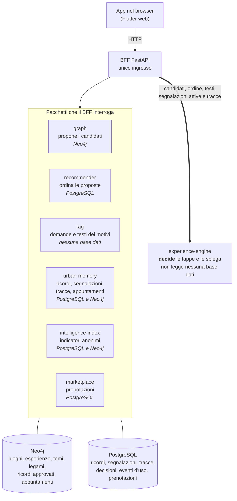

# Lucca Soul Lab

Un'app che compone una giornata a piedi nel centro di Lucca a partire da sei domande, e spiega
ogni scelta. Per esempio, in una prova con le risposte «musica» e «mezza giornata», la giornata
comincia da San Michele in Foro: «in questa chiesa il giovane Giacomo Puccini dava lezioni
d'organo». Accanto, una leggenda sulla facciata e la sua fonte.

## Stato

Prototipo dimostrativo. Non è in linea: gira sul computer di chi lo avvia.
README aggiornato al 14 novembre 2026.

## Cosa fa oggi

- **Compone l'itinerario dalle risposte.** Sei domande (voglia di perdersi, silenzio o musica,
  bellezza o storie, bambini, tempo, accessibilità) diventano una giornata di tappe in ordine.
- **Si adatta a un cambiamento.** Tre interruttori simulano «Piove», «Troppa folla» e
  «Stanco/a». Con «Piove», per esempio, una tappa all'aperto diventa una al chiuso e la
  scheda dice «Sostituita per la pioggia». Con «Troppa folla» una tappa all'aperto in un luogo
  affollato lascia il posto a un'alternativa vicina, mai a più di 300 metri a piedi in più;
  se non ce n'è una, la tappa resta e la scheda lo dice. Con «Stanco/a» la giornata si accorcia,
  e aggiungere altri segnali non le dà mai più tappe di quante ne terrebbe la sola stanchezza. Si può tornare al
  percorso iniziale.
- **Mostra gli orari.** Per ogni tappa l'ora di arrivo e la durata, per la giornata l'intervallo
  complessivo.
- **Mostra la mappa.** Le tappe numerate su una mappa, con un link «Come arrivo qui».
- **Spiega con le fonti.** Ogni tappa ha un motivo leggibile; curiosità e leggende riportano la fonte.
- **Raccoglie ricordi.** Da ogni tappa si può lasciare un ricordo (racconto, foto, musica, mestiere,
  ricetta, dialetto, testimonianza), solo con consenso esplicito e una licenza. Va in revisione
  prima di essere pubblicato. Una vista per i cittadini elenca, luogo per luogo, i ricordi approvati.

## La memoria della città: cosa resta scritto

L'itinerario si compone e si dimentica. Due cose invece restano, e sono il motivo per cui il
progetto esiste: quello che le persone raccontano, e quello che in città accade e ritorna.

**I ricordi delle persone.** Un ricordo si salva solo con consenso esplicito e con una licenza: è
la base dati stessa a rifiutare un ricordo che ne è privo. Di chi lo lascia resta uno
pseudonimo, mai un nome. Una persona lo rivede prima che compaia, e compare solo se il luogo di
cui parla esiste davvero tra quelli della città. Un ricordo scartato non viene cancellato: resta
segnato come scartato, con la data e il motivo.

**Ciò che accade ora, e ciò che ritorna.** Un musicista suona in una piazza: è un fatto che dura
poco.

1. **Segnalazione.** Il fatto viene registrato con un luogo, uno o più temi e una scadenza, al
   massimo 24 ore. Finché è valido, chi cerca quel tema può trovarlo come tappa in più. Niente di
   commerciale entra per questa strada.
2. **Traccia.** Alla scadenza il fatto sparisce dagli itinerari, ma lascia una riga: il luogo, i
   temi, la data. Niente nomi, niente testo. Le tracce si aggiungono e non si modificano.
3. **Ricorrenza.** Quando nello stesso luogo, sugli stessi temi, le tracce sono almeno tre e
   cadono a intervalli regolari, il sistema lo fa notare. Non decide nulla.
4. **Decisione.** Una persona approva o rifiuta, una proposta alla volta. Se approva, nasce un
   appuntamento ricorrente della città, con la sua cadenza. Resta scritto chi ha deciso e quando,
   sempre con uno pseudonimo.
5. **Freno.** Un appuntamento si può togliere in ogni momento, e chi lo toglie deve scrivere perché.
   Se smette di ripetersi viene sospeso, ma solo quando qualcuno lancia il controllo: oggi non
   parte da solo.

Le tracce servono anche a una frase: quando in un luogo se ne sono accumulate abbastanza, il
motivo di una tappa può dire «È un luogo che torna spesso a vivere di musica».

Cosa manca, detto chiaro:

- **Dall'app non si può segnalare nulla.** Oggi segnalazioni, decisioni e freno si fanno solo da
  riga di comando, da chi gestisce l'installazione. Chi può segnalare, e con quale controllo, è
  una scelta ancora da fare.
- **Non c'è ancora nessuna segnalazione reale.** Il meccanismo è costruito e provato dai test, non
  dall'uso.
- **Serve la base dati.** Nella prova senza `.env` i ricordi durano fino allo spegnimento e delle
  segnalazioni non resta nulla.

## Cosa è vero e cosa è d'esempio

- **Luoghi reali:** 24 luoghi del centro storico e 35 esperienze.
- **Coordinate:** rilevate a mano dal committente su Google Maps il 22 ottobre 2026. Le distanze a
  piedi sono stime: linea d'aria moltiplicata per 1,3.
- **Orari:** ogni orario dichiara la sua fonte. Quattro vengono da siti ufficiali, gli altri sono
  indicati dal committente; alcuni sono stime dichiarate come tali.
- **Botteghe inventate:** le 5 botteghe artigiane sono esempi dimostrativi, non esercizi reali.
  La tappa lo dice già da chiusa, sotto il titolo («Bottega inventata per la demo»); il motivo
  lo ripete («esempio dimostrativo») e non hanno un punto sulla mappa.
- **Ricordi d'esempio:** i 4 ricordi caricati per la demo sono testi del committente, segnati
  «(esempio dimostrativo)».
- **Nessun dato reale di affollamento o di meteo.** I cambiamenti li simula chi usa l'app.
  «Troppa folla» segna come affollati via Fillungo e San Michele in Foro: un elenco scritto a mano,
  non una misura. Il cruscotto per gli enti non ha dati reali da mostrare.

## Cosa non fa

- Non verifica che una persona sia stata davvero in un luogo.
- Non conosce festività, chiusure straordinarie o posti disponibili: solo fasce orarie settimanali.
- I contenuti sono stati raccolti con cura ma non verificati sul posto.
- Non esiste un'app per telefono: l'app gira nel browser.
- Un'installazione serve una sola città. La separazione tra motore e contenuti di una città è
  provata solo su un borgo inventato, mai su una seconda città reale.

L'elenco completo, con cosa servirebbe per superare ogni limite, è in
[`I_LIMITI_DEL_MOTORE.md`](I_LIMITI_DEL_MOTORE.md) e [`docs/LIMITI.md`](docs/LIMITI.md).
Alcune voci di quei file sono state superate dal codice e lo dichiarano.

## Le regole che il codice fa rispettare

Ogni regola è protetta da test automatici, eseguiti a ogni invio del codice su GitHub.

| Regola | Dove è protetta |
|---|---|
| **Pagare non fa salire nessuno.** L'abbonamento decide solo se una bottega partner compare, mai dove. Le botteghe di oggi sono tutte dimostrative. | `services/experience-engine/tests/test_engine.py` (`test_scoring_non_usa_partner_id_ne_prezzo`, `test_scoring_bit_identico_con_abbonamento_e_prenotabilita_variati`, `test_partner_non_attivo_escluso_dai_filtri_duri`) |
| **Ogni decisione è spiegata.** Nessuna tappa, tolta o sostituita, resta senza un motivo. | `packages/contracts/contracts/models.py` (motivo obbligatorio); `services/experience-engine/tests/test_engine.py` (`test_ogni_tappa_ha_reason_non_vuoto`); `services/experience-engine/tests/test_escluse_reason_canonico.py` |
| **Nessun ricordo senza consenso e licenza.** | `services/urban-memory/tests/test_service.py`; vincoli del database in `services/urban-memory/tests/test_repository.py` (eseguiti in CI su Linux) |
| **Evitare la folla non fa camminare molto di più, e la pioggia ha la precedenza.** Una sostituzione per la folla aggiunge al massimo 300 metri a piedi; la folla tocca solo le tappe all'aperto, e sotto la pioggia una tappa non resta mai all'aperto per colpa della folla. | `services/experience-engine/tests/test_folla_limite_cammino.py`, `services/experience-engine/tests/test_folla_al_chiuso.py`, `tests/test_valore_folla_app.py` |
| **Sotto le 10 persone il dato non si mostra.** Indicatori e mappa dei flussi del cruscotto restano nascosti. | `services/intelligence-index/tests/test_index.py`, `services/intelligence-index/tests/test_intelligence_index_dashboard.py`, `services/api/tests/test_dashboard.py` |

## Per chi vuole provarlo

Prerequisiti: Windows con PowerShell, Git, Python 3.13, Flutter (la CI usa 3.47.7), accesso a
Internet per i pacchetti e per la mappa.

```powershell
git clone https://github.com/ssurli/lucca-soul-engine.git
cd lucca-soul-engine
python -m venv .venv
.venv\Scripts\python.exe -m pip install -e packages\contracts -e services\graph -e services\rag -e services\experience-engine -e services\urban-memory -e services\marketplace -e services\recommender -e services\intelligence-index -e services\api
powershell -ExecutionPolicy Bypass -File scripts\avvia_demo.ps1
```

Su Windows `-e services\api` installa anche `pip-system-certs` (serve al driver Neo4j per fidarsi del certificato di Aura).

Lo script costruisce l'app web, avvia il BFF sulla porta 8000 e stampa gli indirizzi: mattina
`http://localhost:8000/`, pomeriggio con `?istante=...`.

**Senza `.env`** la demo funziona con i dati versionati nel repo. È stata provata così su una
copia pulita: itinerario, adattamento, ricordo inviato, vista Cittadino e dashboard si aprono.
Differenze: i ricordi restano in memoria fino allo spegnimento, nessun ricordo risulta approvato
e la dashboard mostra solo «dato insufficiente».

**Con Neo4j Aura e Neon:** copia `.env.example` in `.env` e compila i valori (Aura vuole
`neo4j+s://`, Neon `sslmode=require`). `scripts\bootstrap.ps1` è facoltativo: verifica le
connessioni e abilita l'estensione `vector` su Neon. Le credenziali stanno solo nel `.env`.

**Demo da un altro dispositivo:**
`powershell -ExecutionPolicy Bypass -File scripts\avvia_demo.ps1 -Rete` ascolta su tutta la rete
locale e stampa questo avviso: «Modalita' -Rete: SOLO per la demo su rete fidata. POST /memory e POST
/booking scrivono su Neon e /docs e' leggibile da chiunque sulla rete.»

**Rete con ispezione TLS:** se Python fallisce con `SSLCertVerificationError`, esegui
`pip install pip-system-certs`: Python userà i certificati di Windows, senza disattivare la verifica.

**Aura Free** si mette in pausa da sola e viene cancellata dopo 30 giorni di inattività. Il seed
del grafo è versionato in `services/graph/cypher/` e si ricarica da zero: procedura in
[`services/urban-memory/README.md`](services/urban-memory/README.md), sezione «Aura cancellata».

Test: `.venv\Scripts\python.exe -m pytest` (più le cartelle `services\*\tests`, come nella CI in
`.github/workflows/`) e `flutter test` in `apps/lucca_soul_app`.

## Com'è fatto

Un solo programma risponde all'app: il BFF. Raccoglie i candidati, l'ordine, i testi e ciò che
accade in città, e li passa al motore. Il motore è l'unico che decide le tappe, e non legge
nessuna base dati: lavora solo su ciò che riceve.



Senza `.env` le due basi dati non servono: il grafo viene letto dai dati versionati nel repo e
niente viene salvato.

**Dove sta ciò che resta scritto**

| Cosa | Dove | Cosa contiene |
|---|---|---|
| Ricordo | PostgreSQL, `memory_contribution` | testo o media, luoghi a cui si riferisce, pseudonimo, consenso, licenza, esito della revisione, eventuale scarto con data e motivo |
| Ricordo approvato | Neo4j, nodo collegato al luogo | il legame tra il ricordo e i luoghi di cui parla |
| Segnalazione | PostgreSQL, `segnale_fluttuante` | descrizione, temi, luogo, scadenza, stato (attiva o scaduta) |
| Traccia | PostgreSQL, `traccia_luogo` | luogo, temi, data; una riga per segnalazione scaduta, solo in aggiunta |
| Ultima traccia di un luogo | Neo4j, proprietà del luogo | la data dell'ultima traccia, ricavata dal registro |
| Appuntamento approvato | PostgreSQL, `pattern_promosso`; Neo4j, nodo evento | luogo, temi, cadenza in giorni, chi ha deciso e quando |
| Proposta rifiutata | PostgreSQL, `pattern_cestinato` | luogo, temi, chi ha deciso, motivo facoltativo |
| Freno | PostgreSQL, `pattern_frenato` | appuntamento, azione (tirato o rilasciato), chi, quando, motivazione obbligatoria per tirarlo |

Gli schemi sono in `services/urban-memory/sql/`; il progetto completo del registro delle tracce è
in [`docs/PROMOZIONE_TRACCIA.md`](docs/PROMOZIONE_TRACCIA.md).

| Cartella | Cosa contiene |
|---|---|
| `apps/lucca_soul_app` | L'app Flutter (web): domande, itinerario, mappa, ricordi, dashboard. |
| `services/api` | Il BFF FastAPI: l'unico ingresso dell'app, serve anche l'app web. |
| `services/experience-engine` | Il motore che decide le tappe, a regole, deterministico e spiegabile. |
| `services/graph` | Il grafo dei luoghi (Neo4j): schema, Cypher, dati della città scelti da `CITY_SEED`. |
| `services/rag` | Le domande iniziali e i testi dei motivi; l'arricchimento via LLM è facoltativo. |
| `services/recommender` | Riordina le proposte penalizzando i luoghi già più frequentati. |
| `services/urban-memory` | I ricordi (consenso, licenza, revisione, aggancio ai luoghi) e ciò che accade: segnalazioni, registro delle tracce, appuntamenti ricorrenti, freno. |
| `services/intelligence-index` | Gli indicatori aggregati e anonimi per la dashboard. |
| `services/marketplace` | Prenotazioni delle botteghe partner; non influisce sul punteggio. |
| `packages/contracts` | I tipi di dati condivisi da tutti i servizi (vedi `docs/DATA_CONTRACTS.md`). |

Il vocabolario del dominio è definito in [`docs/DATA_CONTRACTS.md`](docs/DATA_CONTRACTS.md).
Gran parte del codice è scritta da agenti di Claude Code, definiti in `.claude/agents/`, ed è
verificata da test e dalla CI su GitHub.

## Contribuire

Due strade, entrambe dalla sezione Issues di GitHub:

- **Contenuti:** segnalare un errore su un luogo, un orario o una fonte, o proporre un contenuto.
- **Codice:** aprire una issue prima di una pull request.

Chi apre una pull request accetta le licenze di [`LICENZE.md`](LICENZE.md).

Autore: Stefano Surlinelli.

## Licenze

- Codice: EUPL-1.2 (`LICENSE`, testo italiano in `LICENSE.it.txt`).
- Documentazione e testi del seed: CC BY 4.0.
- Foto, logo delle Mura e nome "Lucca Soul Lab": tutti i diritti riservati.

Dettagli, eccezioni e terze parti in [`LICENZE.md`](LICENZE.md).
